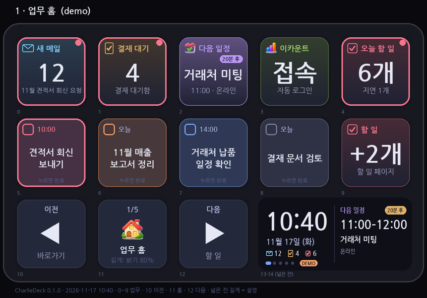

<div align="center">

# CharlieDeck

**Ulanzi D200 의 13개 버튼으로 보는 Windows 11 개인 업무 대시보드**<br>
하이웍스 메일 · 결재 대기 · Google 일정 · Todoist 할 일 · 이카운트ERP 자동 접속



</div>

## 이런 걸 해요

| 칸 | 보여주는 것 | 누르면 |
|---|---|---|
| 메일 | 하이웍스 새 메일 수 (POP3) | 메일함 열기 + 새 메일 0 으로 |
| 결재 대기 | 하이웍스 결재 대기함의 숫자 (업무 브라우저가 화면에서 읽음) | 결재함 열기 · 로그인이 풀렸으면 로그인 창 |
| 다음 일정 | Google 캘린더 오늘 일정 (비공개 iCal 주소) | 다가오는 일정 3개 |
| 이카운트 | — | 업무 브라우저에서 자동 로그인 |
| 할 일 | Todoist 오늘 + 지연 할 일, 홈에 5개 | **누르면 완료** (8초 안에 다시 누르면 취소) |

하이웍스 · 이카운트는 API 를 쓰지 않아요. CharlieDeck 전용 Chrome 창(**업무 브라우저**)에 한 번 로그인해 두면,
그 창이 결재 대기함 화면의 숫자를 읽고 이카운트 로그인 칸을 채워요.

## 빠른 시작 (Windows 11)

```bat
scripts\windows\setup.bat            :: 처음 한 번: .venv 만들고 패키지 설치 (Python 3.11 이상)
scripts\windows\run-demo.bat --sim   :: D200 없이 가짜 데이터로 미리 보기
scripts\windows\settings.bat         :: 설정 창: 계정·비밀번호·토큰·주소 입력
scripts\windows\run-sim.bat          :: D200 없이 실제 데이터 확인
scripts\windows\run.bat              :: D200 으로 실행 (Ulanzi Studio 는 꺼 두세요)
```

자세한 설정 방법은 **[docs/CHARLIEDECK.md](docs/CHARLIEDECK.md)** 에 있어요.

## 보안

- 계정 · 비밀번호 · 토큰 · 비공개 일정 주소는 **설정 창에서 입력**하고 **Windows 자격 증명 관리자**에 암호화 저장돼요.
  코드 · 설정 파일 · exe 안에는 들어가지 않아요.
- 회사 주소(하이웍스 메일함 · 결재함 등)도 코드에 없어요. 설정 창에서 넣은 값은 `%APPDATA%\CharlieDeck\charliedeck.json` 에만 저장돼요.
- POP3 는 메일 머리글만 읽고 메일을 지우지 않아요. 업무 브라우저가 누르는 단추는 이카운트 로그인 단추 하나뿐이에요.

## 크레딧 · 라이선스

MIT ([LICENSE](LICENSE)). [agentdeck](https://github.com/jakeparkcolde/agentdeck) (© 2026 jakeparkcolde) 를 바탕으로 만들었고,
D200 통신은 [redphx/strmdck](https://github.com/redphx/strmdck) (MIT) 와
[jcalado/companion-surface-d200](https://github.com/jcalado/companion-surface-d200) 의 분석을 따릅니다 ([NOTICE](NOTICE)).
펌웨어는 수정하지 않아요. CharlieDeck 을 끄고 Ulanzi Studio 를 켜면 원래대로 돌아가요.
