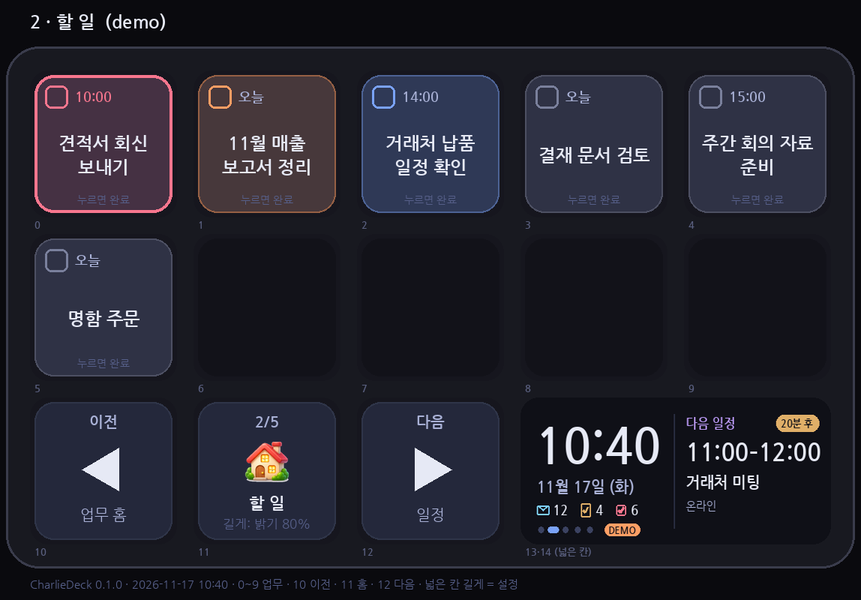
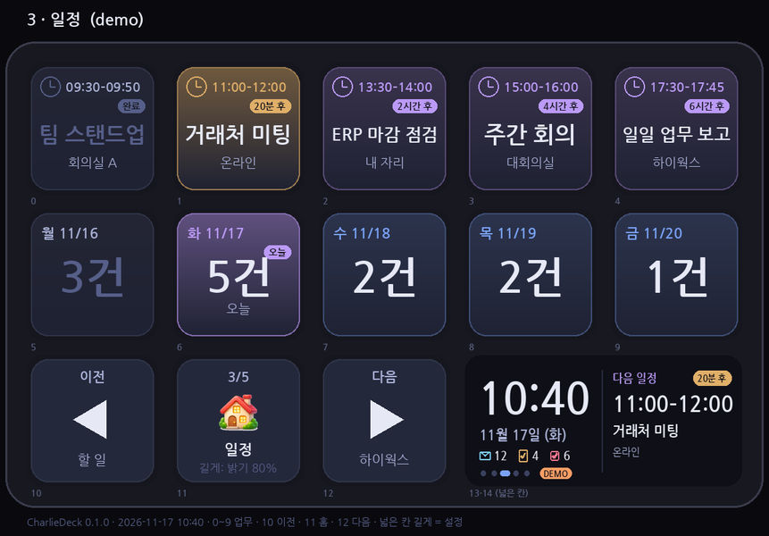
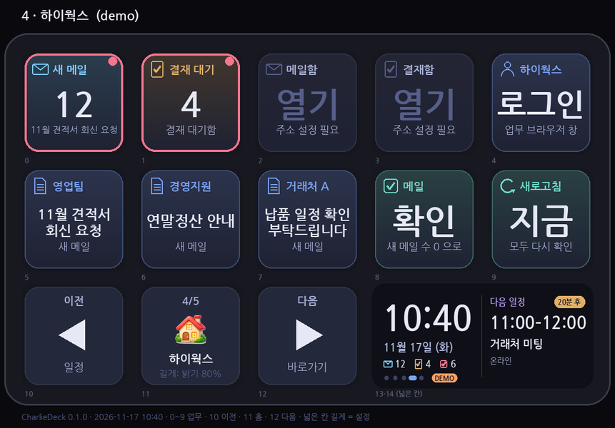
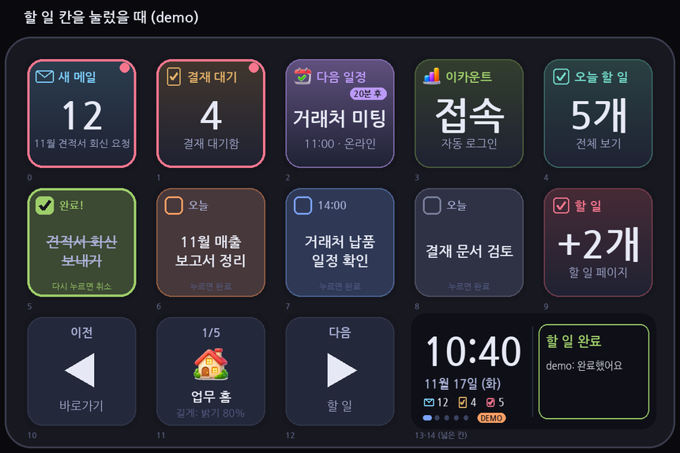
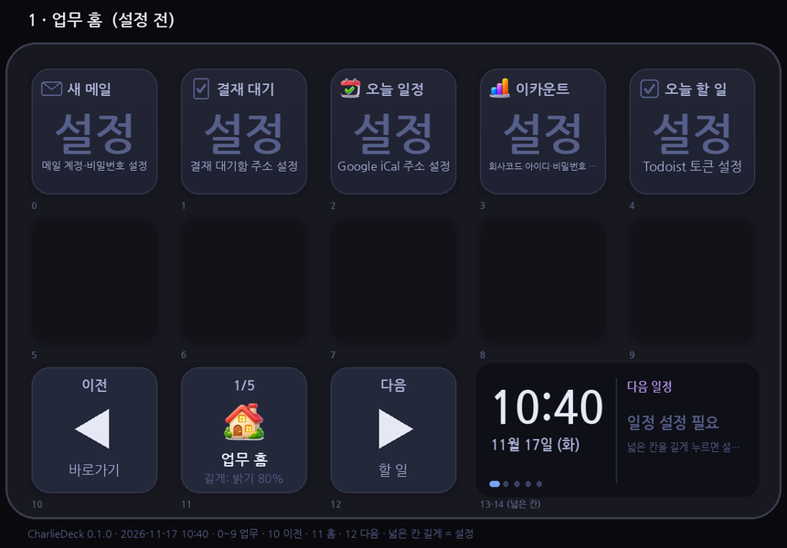
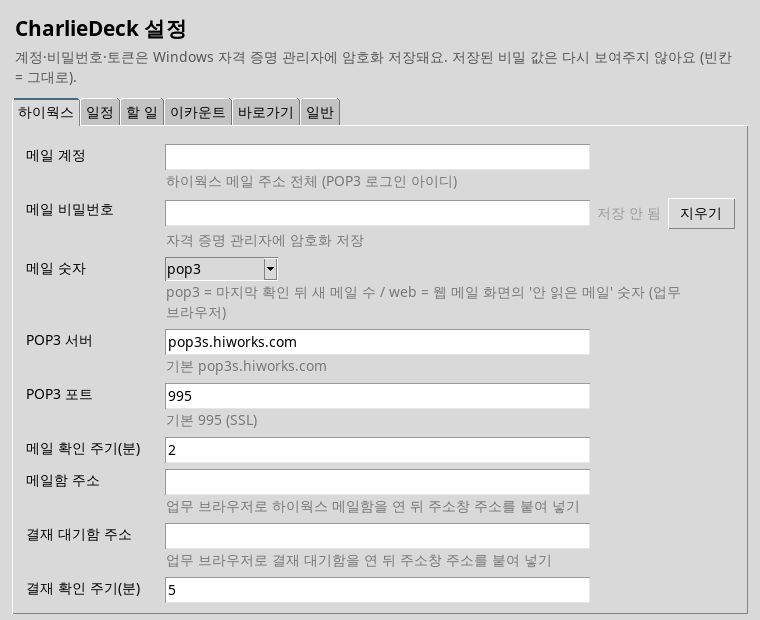

# CharlieDeck 사용 가이드 (Windows 11)

## 1. 버튼 배치

```
[ 0][ 1][ 2][ 3][ 4]
[ 5][ 6][ 7][ 8][ 9]        0~9  업무 버튼 (페이지마다 다름)
[10][11][12][ 넓은 칸 ]     10 이전 · 11 홈 · 12 다음 / 넓은 칸: 시간 · 날짜 · 메일·결재·할 일 수 · 다음 일정
```

| 버튼 | 짧게 | 길게 (0.8초 이상) |
|---|---|---|
| 10 / 12 | 이전 / 다음 페이지 (끝에서 처음으로 돌아감) | |
| 11 | 업무 홈 (홈에서는 모든 연결 새로고침) | 밝기 20 → 50 → 80 → 100% |
| 넓은 칸 | 다가오는 일정 3개 | **PC 화면에 설정 창 열기** |

## 2. 페이지

| # | 페이지 | 내용 |
|---|---|---|
| 1 | 업무 홈 | 메일 · 결재 대기 · 다음 일정 · 이카운트 접속 · 오늘 할 일 수 / 할 일 5개 |
| 2 | 할 일 | Todoist 할 일 10개 (누르면 완료) |
| 3 | 일정 | 오늘 일정 5개 (진행 중 · 곧 시작 강조) / 이번 주 월~금 일정 수 |
| 4 | 하이웍스 | 메일 · 결재 대기 · 메일함 · 결재함 · 하이웍스 로그인 / 최근 메일 3개 · 메일 확인 · 새로고침 |
| 5 | 바로가기 | 설정 창에서 넣은 주소 최대 10개 |

| 할 일 | 일정 |
|---|---|
|  |  |
| **하이웍스** | **할 일을 눌렀을 때** |
|  |  |

설정 전 화면 (칸을 누르면 설정 창):



칸 테두리: **빨강** = 확인할 것이 있음(새 메일 · 결재 대기 · 지연된 할 일) / **노랑** = 로그인 필요 / 흐림 = 설정 필요.
설정이 필요한 칸을 누르면 설정 창이 열려요.

## 3. 설치

1. [Python 3.11 이상](https://www.python.org/downloads/windows/) 설치 (기본 옵션 그대로. tcl/tk 가 함께 설치돼야 설정 창 · 시뮬레이터가 떠요)
2. 저장소 폴더에서 `scripts\windows\setup.bat`
3. **Ulanzi Studio 종료** (켜져 있으면 D200 을 잡고 있어 연결되지 않아요)

D200 은 Windows 기본 HID 드라이버로 동작해요. Zadig 등으로 WinUSB/libusb 드라이버로 바꾸지 마세요.

## 4. 설정 (`scripts\windows\settings.bat` 또는 넓은 칸 길게)



처음 실행하면 설정 창이 자동으로 열려요. 비밀 값은 저장한 뒤 다시 보여주지 않아요 (빈칸으로 두면 그대로, **지우기** 를 누르고 저장하면 삭제).
실행 중인 CharlieDeck 은 저장을 감지해 몇 초 안에 새 설정을 적용해요.

### 하이웍스 메일 (POP3)
- **메일 계정** = 하이웍스 메일 주소 전체, **메일 비밀번호** 입력 → **메일 연결 테스트**
- 서버는 기본값 `pop3s.hiworks.com` / `995` (SSL) 그대로
- POP3 는 '읽음' 정보를 몰라서 **새 메일 = 마지막으로 메일 칸을 누른 뒤 새로 온 메일 수**예요.
  메일 칸을 누르면 메일함이 열리고 숫자가 0 이 돼요. 메일은 서버에서 지우지 않아요 (머리글만 읽음).
- 하이웍스 웹 메일의 '안 읽은 메일' 숫자가 필요하면 **메일 숫자 = web** 으로 바꾸고 메일함 주소를 넣으세요 (업무 브라우저가 읽음).

### 하이웍스 결재 대기 (업무 브라우저)
1. **하이웍스 로그인 (업무 브라우저)** 단추 → 열린 Chrome 창에서 하이웍스에 로그인 (로그인 상태 유지 체크 권장)
2. 그 창에서 메일함 · 결재 대기함으로 가서 주소창의 주소를 복사해 **메일함 주소 / 결재 대기함 주소** 에 붙여 넣기
3. **결재 숫자 읽기 테스트** → `결재 대기 4건 — 읽은 부분: …` 이 나오면 끝
4. 숫자를 못 찾으면 테스트 결과에 화면 글자가 일부 보여요. 그 글자에 맞게 **결재 숫자 규칙(고급)** 을 넣으세요.
   예: 화면에 `미결재 문서 7` 이라고 보이면 `미결재\s*문서\D*(\d+)`
- 기본은 창 없이 5분마다 읽어요. 막히면 **창 없이 읽기** 를 끄세요 (최소화된 창으로 읽음).
- 로그인이 풀리면 결재 칸이 노랗게 바뀌어요. 누르면 업무 브라우저 창이 열리고, 로그인하면 1분 안에 다시 읽어요.

### Google 일정
Google 캘린더 → 설정(톱니) → 왼쪽 **내 캘린더** 에서 캘린더 선택 → **캘린더 통합** → **iCal 형식의 비공개 주소** 복사 → 붙여 넣기 → **일정 가져오기 테스트**.
이 주소는 비밀번호처럼 다뤄 주세요 (누구든 주소만 있으면 일정을 볼 수 있어요). 10분마다 가져와요.

### Todoist
Todoist 웹 → 설정 → **연동** → **개발자** → **API 토큰** 복사 → 붙여 넣기 → **Todoist 테스트**.
필터 기본값은 `today | overdue` (오늘 + 지연). 1분마다 가져와요.
할 일 칸을 누르면 바로 '완료' 로 보이고, **8초 안에 다시 누르면 취소**, 8초가 지나면 Todoist 에 완료가 반영돼요.

### 이카운트ERP
**회사코드 · 아이디 · 비밀번호** 입력 → **지금 접속해 보기**.
덱에서 이카운트 칸을 누르면 업무 브라우저 창에서 로그인 화면을 열고 입력 · 로그인 단추까지 눌러요.
이카운트가 '다른 곳에서 접속 중' 같은 안내를 띄우면 그 창에서 직접 선택하세요.

### 바로가기
한 줄에 `이름 | 주소` (최대 10개). 하이웍스 · 이카운트 주소는 로그인된 업무 브라우저로, 나머지는 평소 Chrome 으로 열려요.

### 일반
밝기 · 길게 누르기 시간 · Chrome 경로(비우면 자동: Chrome → Edge) · **Windows 로그인할 때 자동 실행**.

## 5. 실행

| 목적 | 명령 |
|---|---|
| D200 없이 가짜 데이터 | `scripts\windows\run-demo.bat --sim` |
| D200 없이 실제 데이터 | `scripts\windows\run-sim.bat` |
| D200 으로 실행 | `scripts\windows\run.bat` (연결될 때까지 5초마다 재시도, 끊겨도 자동 재연결) |
| 모든 화면 PNG 저장 | `scripts\windows\snapshot.bat` → `snapshots\` (demo + 설정 전) |
| 자동 실행 등록 / 해제 | 설정 창 → 일반, 또는 `install-startup.bat` / `uninstall-startup.bat` |

시뮬레이터: 마우스로 칸 누르기 (0.8초 이상 = 길게) · `←` `→` 이전/다음 · `H` 홈 · `1`~`0` 업무 버튼 · `S` 설정 · `Esc` 종료.

직접 실행할 때: `.venv\Scripts\python.exe -m charliedeck [--demo] [--sim] [--setup] [--snapshot DIR] [--list-devices] [--list-fonts]`

## 6. 파일 위치

| 용도 | 위치 |
|---|---|
| 일반 설정 (주소 · 주기) | `%APPDATA%\CharlieDeck\charliedeck.json` |
| 계정 · 비밀번호 · 토큰 · iCal 주소 | 제어판 → 자격 증명 관리자 → Windows 자격 증명 → `CharlieDeck` |
| 업무 브라우저 (하이웍스 · 이카운트 로그인 쿠키) | `%LOCALAPPDATA%\CharlieDeck\browser` |
| 로그 (1MB × 4개 순환) | `%LOCALAPPDATA%\CharlieDeck\logs\charliedeck.log` |
| 메일 확인 기준 (메일 ID 해시만) | `%LOCALAPPDATA%\CharlieDeck\mail_seen.json` |
| 자동 실행 | `%APPDATA%\Microsoft\Windows\Start Menu\Programs\Startup\CharlieDeck.vbs` |

모두 지우면 처음 상태로 돌아가요. 업무 브라우저 폴더에는 로그인 쿠키가 있으니 공유 · 백업 폴더에 두지 마세요.

## 7. 문제 해결

| 증상 | 확인 |
|---|---|
| `D200 을 찾지 못했어요` | USB 케이블(충전 전용 아님), Ulanzi Studio 종료, `--list-devices` |
| `D200 을 열지 못했어요` | Ulanzi Studio · Bitfocus Companion 등 다른 프로그램이 장치를 쓰는 중 |
| 한참 뒤 연결이 끊김 | 장치 관리자 → USB 루트 허브 → 전원 관리 → '전원을 절약하기 위해…' 해제 |
| 메일 `로그인 실패` | 하이웍스 메일 환경설정에서 POP3 사용이 켜져 있는지, 계정이 메일 주소 전체인지 |
| 결재 칸이 계속 노랑 | 업무 브라우저 창에서 하이웍스에 다시 로그인 (로그인 상태 유지) |
| 결재 `숫자를 못 찾았어요` | 설정 → 결재 숫자 읽기 테스트 → 보이는 글자에 맞게 고급 규칙 |
| 일정 `주소 오류 (404)` | iCal 비공개 주소를 다시 복사 (재설정하면 이전 주소는 막힘) |
| 할 일 `토큰 확인 필요` | Todoist API 토큰 다시 복사 |
| 글자가 네모로 보임 | `--list-fonts` 로 맑은 고딕 경로 확인 |

## 8. 코드 구조

```
charliedeck/
  __main__.py   실행 옵션 · 실행 루프 · D200 재연결 · 설정 변경 감지 · --snapshot
  app.py        상태 기계: 페이지 · 버튼 입력 · 화면 프레임 (장치와 무관)
  pages.py      페이지별 버튼 10개 정의
  render.py     Pillow 그리기: 업무 칸 · 할 일 칸 · 이전/홈/다음 · 넓은 칸 · 기기 모양 시트
  model.py      화면 데이터 · 할 일 완료/취소 · DemoProvider
  live.py       실제 연결: POP3 · 결재(업무 브라우저) · Google iCal · Todoist · 이카운트
  browser.py    업무 브라우저 (전용 Chrome 프로필 + 127.0.0.1 원격 디버깅)
  settings.py   일반 설정 (charliedeck.json) + 인증정보 차단
  vault.py      비밀 값 (Windows 자격 증명 관리자)
  setup_ui.py   설정 창 (Tkinter) + 연결 테스트
  backends.py   D200 · 시뮬레이터 · 헤드리스
  startup.py    Windows 시작프로그램 (.vbs)
fonts.py          글꼴 (맑은 고딕 · Segoe UI)
platform_util.py  Windows 경로 · 브라우저 열기 · 토스트
d200.py           D200 HID 드라이버
explore.py        D200 HID 원시 리포트 기록 (진단)
```

테스트: `.venv\Scripts\python.exe -m pytest -q tests` (D200 · 네트워크 · 로그인 없이 돌아요)
